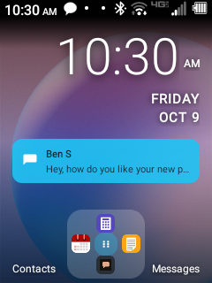
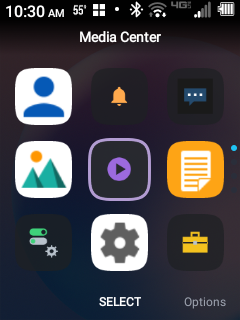

A KaiOS-style Android Home screen for Kyocera keypad flip phones: the DuraXV
Extreme **E4810 / E4811** and the **E4610**.

  
  

### What it does

- **Speed dial**: hold a digit on Home to dial that speed-dial number (hold 1
  for voicemail).
- **Call key** opens the phone's call log, like Kyocera Home does.
- **Soft keys and D-pad** each open an app you choose.
- **Outer buttons** (SOS, outer END, Speaker, PTT) can each open an app.
- **Kyocera's menus** (Media Center, Tools, Quick Settings) are in the app list.
- **Notifications on Home**, with dots on app icons, and optional read-aloud.

### What the installer sets up

- Lets the launcher read your call log and contacts and place calls (for speed
  dial and the call log).
- Turns on its **Accessibility** service, which shows new notifications on Home.
  This is needed on the E4810 / E4811, where Notification Access is blocked.
- Turns on **Notification Access** (where the phone allows it).
- Makes it your **default Home screen**.

### Undo

To go back to the phone's own Home screen, open **Settings → Apps → Default
apps → Home app** on the phone. Or uninstall Flip Launcher from **Settings →
Apps**.

[Source code and full feature list on GitHub](https://github.com/Ben-Showalter/flip-launcher)
